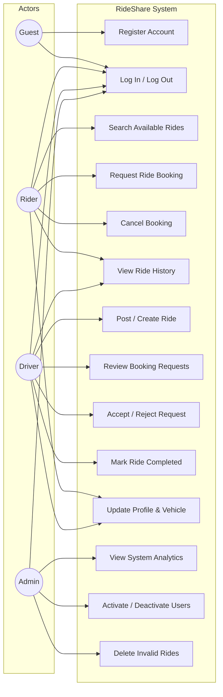
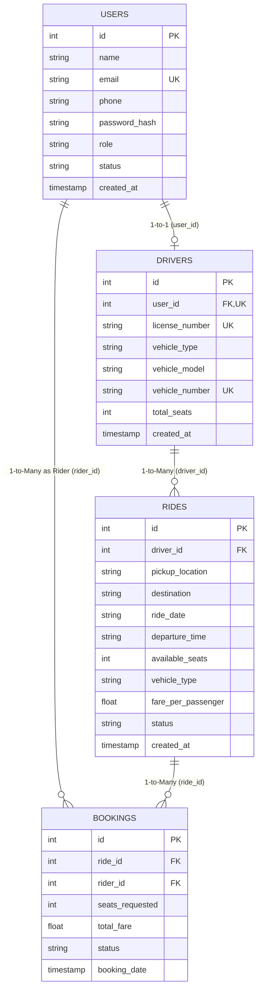
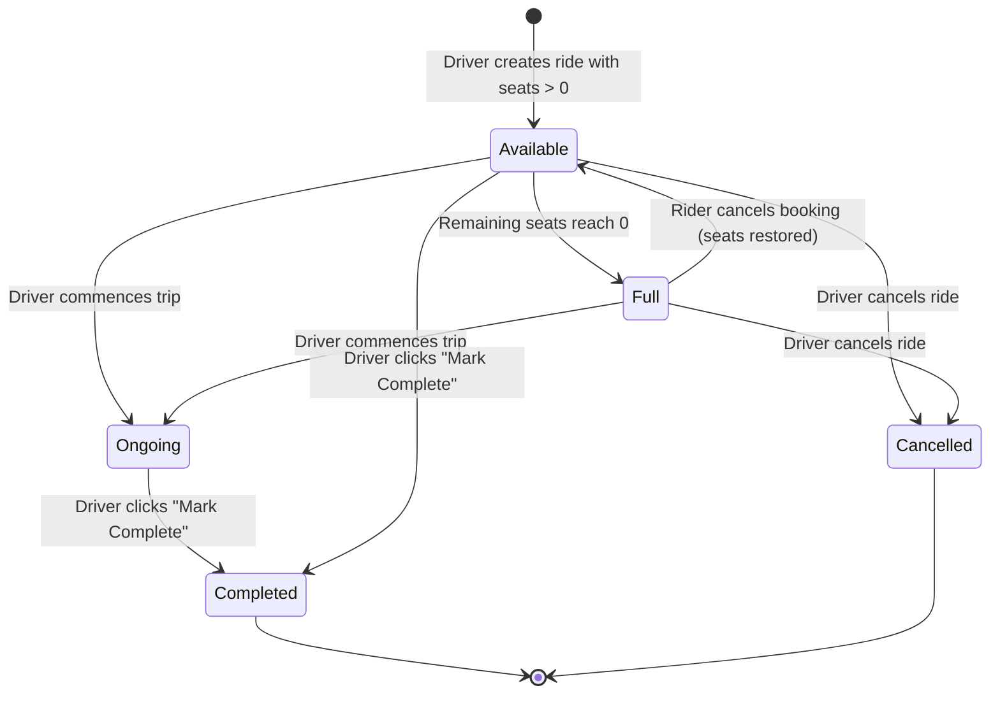
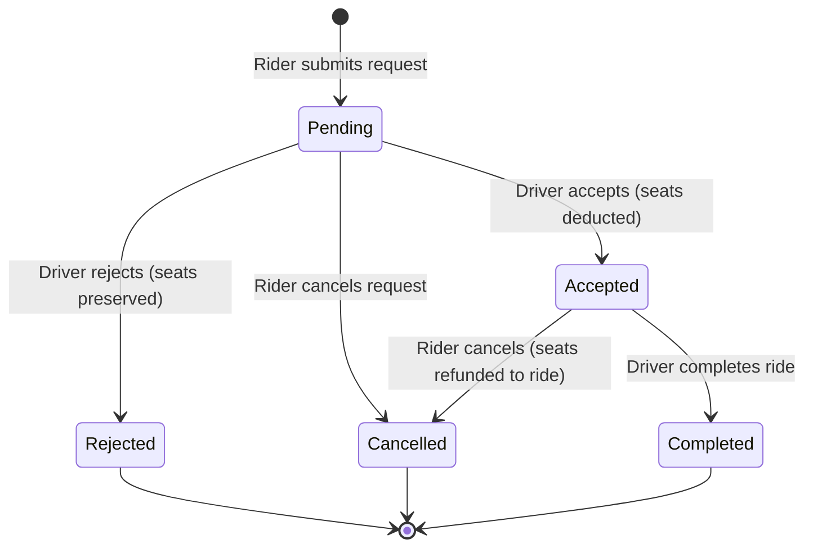

# RideShare – Software Engineering Project Documentation

**Project Title:** RideShare – Peer-to-Peer Ride Sharing Web Application  
**Course:** Software Engineering Mini Project (B.Tech Level)  
**System Architecture:** Three-tier MVC with Flask, Relational Database (SQLite / PostgreSQL Supabase), and Responsive Jinja2 Frontend.

---

## 1. Project Overview & Problem Statement

Urban commuting and college travel corridors suffer from inefficient single-occupant vehicular transit, increasing commuting expenses and traffic congestion. **RideShare** is a web-based ride-sharing application designed to connect verified drivers offering vacant seats with riders traveling along intersecting routes.

### Key Learning & Architectural Objectives:
- Implement complete requirements analysis and use-case modeling.
- Apply modular, decoupled software architecture (separation of presentation, business logic, routing, and persistence layers).
- Model relational database entities with strict foreign key constraints and referential integrity.
- Implement role-based authentication and authorization (Rider, Driver, Administrator).
- Enforce business invariants: preventing overbooking, ensuring state transition consistency, and preventing duplicate active bookings.
- Document and execute automated unit and integration tests (TC01–TC14).

---

## 2. System Requirements

### 2.1 Functional Requirements (FR)
- **FR01 User Registration:** Commuters can register as Riders or Drivers with credential validation (full name, email format, valid phone, password minimum 6 characters).
- **FR02 Driver Specifications:** Driver registration mandates driving license number, vehicle type (Sedan, Hatchback, SUV, etc.), model, vehicle registration number, and seat capacity.
- **FR03 Secure Authentication:** Login verifies email and hashed passwords. Session tracks identity and role.
- **FR04 Role-Based Authorization:** Directs users to role-specific views (Rider Dashboard, Driver Dashboard, Admin Console) and blocks unauthorized cross-access.
- **FR05 Ride Creation (Driver):** Drivers post rides specifying pickup, destination, travel date, departure time, seat availability, and fare per passenger.
- **FR06 Ride Search & Filtering (Rider):** Riders query available rides by pickup location, destination, date, vehicle type, and required seats (case-insensitive substring matching).
- **FR07 Fare Estimation:** System computes estimated fare using formula: `Base Fare (₹30) + (Distance in KM × ₹12/KM)` with a clear demo calculation disclaimer. Drivers can also input custom fares.
- **FR08 Ride Booking Request:** Riders submit requests for available seats. The system validates seat availability and generates a booking with `Pending` status.
- **FR09 Overbooking Prevention:** System prevents booking requests or acceptance when requested seats exceed remaining seats.
- **FR10 Duplicate Booking Prevention:** System prevents the same rider from submitting multiple simultaneous active bookings on the same ride.
- **FR11 Booking Acceptance/Rejection (Driver):** Drivers can accept pending requests (which decrements available seats and transitions ride status to `Full` if seats reach 0) or reject requests.
- **FR12 Booking Cancellation (Rider):** Riders can cancel pending or accepted bookings; cancellation of an accepted booking automatically restores the seat capacity.
- **FR13 Ride Completion:** Drivers mark rides as `Completed`, which automatically updates all accepted passenger bookings to `Completed` and saves them to history.
- **FR14 Profile Management:** Users view and update personal contact info. Drivers can update vehicle specifications.
- **FR15 Administrative Moderation:** Admin views platform metrics, toggles user active/inactive status, views all rides/bookings, and deletes invalid listings.

### 2.2 Non-Functional Requirements (NFR)
- **NFR01 Security:** No passwords stored in plain text. Passwords hashed using Werkzeug PBKDF2:SHA256. Parameterized SQL queries throughout to eliminate SQL injection.
- **NFR02 Usability & Responsiveness:** Mobile-responsive interface using CSS flexbox/grid, accessible typography, clear feedback alerts, and modal dialogs.
- **NFR03 Reliability & Integrity:** Relational foreign keys with cascading constraints (`ON DELETE CASCADE`) and transactional integrity.
- **NFR04 Performance:** Sub-100ms response time on local queries with database indices on frequent lookup fields (`email`, `pickup_location`, `destination`, `ride_date`, `status`).
- **NFR05 Maintainability:** Modular folder structure isolating routes, models, business services, and database utilities.

---

## 3. Actors & Use Case Modeling

### 3.1 Actors
1. **Rider:** An authenticated commuter who searches, requests, and manages ride bookings.
2. **Driver:** An authenticated vehicle owner who posts itineraries, reviews requests, allocates seats, and executes rides.
3. **Administrator:** A system operator who monitors analytics, moderates listings, and manages accounts.
4. **Guest:** An unauthenticated visitor who views landing page, platform overview, and initiates login/registration.

### 3.2 Use Case Diagram



---

## 4. Software Architecture & Modular Design

RideShare follows a clean, modular MVC (Model-View-Controller) / Service-oriented architecture:

```
sen project/
├── app.py                     # Application factory & global error handlers
├── config.py                  # Environment & database configuration
├── run.py                     # Entry-point runner script
├── requirements.txt           # Dependency manifest
│
├── database/                  # Data persistence layer
│   ├── schema.sql             # Relational SQLite DDL schema
│   ├── supabase_schema.sql    # PostgreSQL / Supabase DDL with RLS policies
│   └── db.py                  # Database connection, pooling & demo seeding
│
├── models/                    # Data Access & Entity logic
│   ├── user.py                # User credentials, hashing, profile CRUD
│   ├── driver.py              # Driver profile & vehicle specifications
│   ├── ride.py                # Itineraries, search filters & ride lifecycle
│   └── booking.py             # Seat reservation, validation & overbooking guard
│
├── services/                  # Business logic services
│   └── fare_service.py        # Algorithmic distance & fare estimation
│
├── auth/                      # Authentication & Security
│   └── decorators.py          # @login_required, @role_required guards
│
├── routes/                    # Modular Blueprint controllers
│   ├── main_routes.py         # Landing page, about, profile management
│   ├── auth_routes.py         # Login, registration, session termination
│   ├── rider_routes.py        # Search, book, cancel, history
│   ├── driver_routes.py       # Create ride, review requests, complete ride
│   ├── admin_routes.py        # Analytics, user status toggle, ride deletion
│   └── api_routes.py          # JSON API for live fare & location endpoints
│
├── templates/                 # Presentation layer (HTML5 / Jinja2)
│   ├── base.html              # Master layout with responsive nav & footer
│   ├── index.html             # Landing page (hero, how-it-works, features, map)
│   ├── about.html             # Software Engineering specifications
│   ├── login.html             # Login with 1-click demo credential fill
│   ├── register_rider.html    # Rider sign-up form
│   ├── register_driver.html   # Driver sign-up with vehicle specs
│   ├── profile.html           # Unified profile view/edit
│   ├── errors/                # 403, 404, 500 error pages
│   ├── rider/                 # Rider dashboard, search, bookings, history
│   ├── driver/                # Driver dashboard, create ride, my rides, requests
│   └── admin/                 # Admin console, users, drivers, rides, bookings
│
├── static/                    # Static presentation assets
│   ├── css/style.css          # Responsive design, color tokens, card layout
│   └── js/
│       ├── main.js            # Client-side validation, live fare preview
│       └── map.js             # Leaflet OpenStreetMap route visualization
│
├── tests/                     # Verification & Quality Assurance
│   ├── __init__.py
│   └── test_rideshare.py      # Automated test suite (TC01–TC14)
│
└── docs/                      # Documentation
    └── SOFTWARE_ENGINEERING_DOCUMENTATION.md
```

---

## 5. Database Design & Entity Relationship (ER) Model

### 5.1 Tables & Schema Definition

1. **USERS:**
   - `id` (INTEGER, PK, AUTOINCREMENT)
   - `name` (TEXT, NOT NULL)
   - `email` (TEXT, UNIQUE, NOT NULL)
   - `phone` (TEXT, NOT NULL)
   - `password_hash` (TEXT, NOT NULL)
   - `role` (TEXT, CHECK: 'rider', 'driver', 'admin')
   - `status` (TEXT, CHECK: 'active', 'inactive')
   - `created_at` (TIMESTAMP)

2. **DRIVERS:**
   - `id` (INTEGER, PK, AUTOINCREMENT)
   - `user_id` (INTEGER, UNIQUE, FK -> USERS.id)
   - `license_number` (TEXT, UNIQUE, NOT NULL)
   - `vehicle_type` (TEXT, NOT NULL)
   - `vehicle_model` (TEXT, NOT NULL)
   - `vehicle_number` (TEXT, UNIQUE, NOT NULL)
   - `total_seats` (INTEGER, CHECK: total_seats > 0)
   - `created_at` (TIMESTAMP)

3. **RIDES:**
   - `id` (INTEGER, PK, AUTOINCREMENT)
   - `driver_id` (INTEGER, FK -> DRIVERS.id)
   - `pickup_location` (TEXT, NOT NULL)
   - `destination` (TEXT, NOT NULL)
   - `ride_date` (TEXT, NOT NULL)
   - `departure_time` (TEXT, NOT NULL)
   - `available_seats` (INTEGER, CHECK: available_seats >= 0)
   - `vehicle_type` (TEXT, NOT NULL)
   - `fare_per_passenger` (REAL, CHECK: fare_per_passenger >= 0)
   - `status` (TEXT, CHECK: 'Available', 'Full', 'Ongoing', 'Completed', 'Cancelled')
   - `created_at` (TIMESTAMP)

4. **BOOKINGS:**
   - `id` (INTEGER, PK, AUTOINCREMENT)
   - `ride_id` (INTEGER, FK -> RIDES.id)
   - `rider_id` (INTEGER, FK -> USERS.id)
   - `seats_requested` (INTEGER, CHECK: seats_requested > 0)
   - `total_fare` (REAL, CHECK: total_fare >= 0)
   - `status` (TEXT, CHECK: 'Pending', 'Accepted', 'Rejected', 'Cancelled', 'Completed')
   - `booking_date` (TIMESTAMP)

### 5.2 Entity Relationship Diagram (ERD)



---

## 6. Behavioral Models & State Transitions

### 6.1 Ride Request Sequence Flow

```mermaid
sequenceDiagram
    autonumber
    actor Rider
    participant WebUI as Frontend (Browser)
    participant Route as Rider Controller
    participant Service as Booking Service
    participant DB as SQLite / Relational DB
    actor Driver

    Rider->>WebUI: Clicks "Request Ride" (Seats = N)
    WebUI->>Route: POST /rider/book/{ride_id}
    Route->>Service: create_request(ride_id, rider_id, N)
    Service->>DB: Query available_seats & existing bookings
    alt Not enough seats or duplicate booking
        DB-->>Service: Return Constraint Violation
        Service-->>Route: Return Error Message
        Route-->>WebUI: Flash Error ("Not enough seats")
    else Valid Request
        Service->>DB: INSERT into bookings (status='Pending')
        DB-->>Service: booking_id
        Service-->>Route: Success
        Route-->>WebUI: Flash Success ("Booking Pending")
    end

    Driver->>WebUI: Opens "Ride Requests"
    WebUI->>Route: GET /driver/requests
    Route->>DB: Query pending bookings for driver's rides
    DB-->>WebUI: Display Request List

    Driver->>WebUI: Clicks "Accept"
    WebUI->>Route: POST /driver/requests/accept/{booking_id}
    Route->>Service: accept_request(booking_id, driver_id)
    Service->>DB: UPDATE bookings SET status='Accepted'
    Service->>DB: UPDATE rides SET available_seats = available_seats - N
    DB-->>WebUI: Seats updated; Rider confirmed
```

### 6.2 State Transition Diagrams

#### Ride State Transition:


#### Booking State Transition:


---

## 7. Testing & Verification Matrix

The test suite is executable via:
```bash
python -m unittest tests/test_rideshare.py
```

All 14 test cases execute against an isolated test database and pass:

| Test ID | Description | Test Inputs | Expected Result | Actual Result | Status |
|:-------:|:------------|:------------|:----------------|:--------------|:------:|
| **TC01** | Valid rider registration | Name, valid email, phone, matching passwords | Account created with role `rider` & status `active`; redirect to login | Account created, redirected to login | **PASSED** |
| **TC02** | Invalid email registration | Email: `not-a-valid-email` | Validation halts process; user-friendly error message returned | "Please enter a valid email address." | **PASSED** |
| **TC03** | Valid user login | `rider@demo.com`, `Rider@123` | Session initialized with user ID and role; dashboard rendered | "Welcome back", 200 OK | **PASSED** |
| **TC04** | Invalid login | `rider@demo.com`, wrong password | Authentication fails; session unassigned; error message displayed | "Invalid email or password." | **PASSED** |
| **TC05** | Driver creates ride | Pickup: North Campus, Dest: South Metro, Seats: 3 | Ride row created in database with status `Available` | Ride created with status `Available` | **PASSED** |
| **TC06** | Rider searches rides | Pickup: `College Road`, Dest: `Railway Station` | Query returns matching available ride cards | Ride returned in search results | **PASSED** |
| **TC07** | Rider requests available ride | Ride 1, Seats: 1 | Booking record created with status `Pending` | Booking status set to `Pending` | **PASSED** |
| **TC08** | Driver accepts booking | Driver accepts 1 seat request on a 2-seat ride | Booking status becomes `Accepted`; remaining seats reduce to 1 | Booking `Accepted`, seats = 1 | **PASSED** |
| **TC09** | Driver rejects booking | Driver rejects booking request | Booking status becomes `Rejected`; ride seat capacity unchanged | Booking `Rejected`, seats = 3 | **PASSED** |
| **TC10** | Prevent overbooking | Requesting 2 seats on a ride with only 1 seat remaining | Booking creation rejected with clear notification | "Not enough seats available" | **PASSED** |
| **TC11** | Rider cancels booking | Rider cancels pending/accepted booking | Booking status becomes `Cancelled`; seats restored if accepted | Status `Cancelled`, seats restored | **PASSED** |
| **TC12** | Driver completes ride | Driver clicks "Mark as Completed" | Ride status -> `Completed`; accepted bookings -> `Completed` | Ride & bookings `Completed` | **PASSED** |
| **TC13** | Unauthorized access guard | Guest accesses `/rider/dashboard`; Rider accesses `/driver/dashboard` | Redirected to login or appropriate home dashboard; access denied | Blocked & redirected (302) | **PASSED** |
| **TC14** | User logout | Authenticated user visits `/logout` | Session destroyed; subsequent dashboard access redirected | Session cleared; 200 OK | **PASSED** |

---

## 8. College Mini-Project Scope & Limitations

### In-Scope Functional Capabilities:
- Full CRUD operations for Rides, Bookings, Profiles, and Accounts.
- Real-time seat inventory decrementing and restoration.
- Overbooking and duplicate booking safeguards.
- Responsive user interface with mobile hamburger menu and Leaflet OpenStreetMap integration.
- Dual-target relational schema (SQLite local engine and Supabase PostgreSQL with Row Level Security policies).

### Explicit Project Boundaries (Non-Production Design):
- Uses simulated demo fare calculations (`Base ₹30 + ₹12/KM`) instead of real financial payment gateways (Stripe/Razorpay) to avoid external API billing or complexity.
- Relies on OpenStreetMap Leaflet CDN to avoid Google Maps paid API keys.
- Operates within standard college mini project architecture without requiring Docker, Kubernetes, or microservices.
